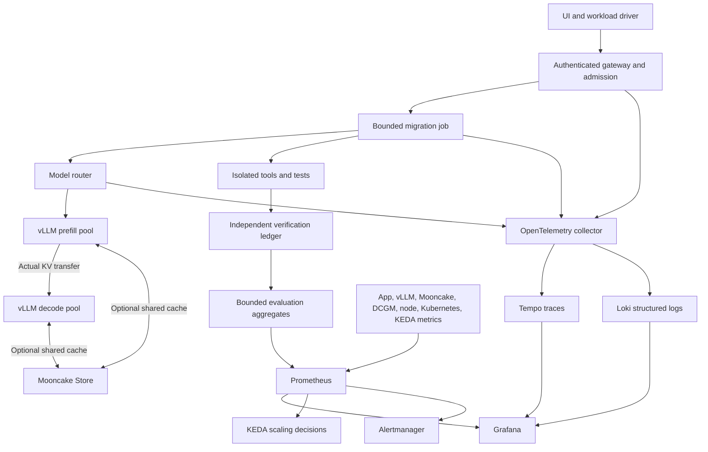

# Observability plan: Private API Maintenance Agent

Planning date: 2026-09-28. Status: design and source research, not deployed instrumentation or measured results.

This plan supports the Stripe invoice-preview migration in [PROJECT_PLAN.md](PROJECT_PLAN.md). Execution experiments are in [BENCHMARK_PLAN.md](BENCHMARK_PLAN.md); presentation and diagnosis are in [DEMO_RUNBOOK.md](DEMO_RUNBOOK.md).

## 1. What the system must let us explain

For any migration job, answer: **Was the patch correct, how long did it take, what limited it, what did it cost, and what happens under contention or failure?**

| Question | Primary evidence | Supporting evidence |
| --- | --- | --- |
| Can we accept more work? | Queue age, admitted concurrency, reserved output/KV budget, measured SLO capacity | Engine waiting/running, preemption, ready capacity |
| Is one tenant harming another? | Per-tenant wait, goodput, rejection and budget consumption | Shared GPU/KV pressure, routing and fairness decisions |
| Why did a request slow down? | Client latency and its trace through admission, model calls and tools | vLLM phase times, transfer spans, host/GPU/network telemetry |
| Does disaggregation help? | Same-hardware SLO goodput and latency comparison | Prefill/decode interference, actual KV bytes/time, recomputation |
| Did private data remain isolated? | Access-control and cache-isolation tests; egress audit | Tenant-scoped artifacts and restricted telemetry |
| Is the migration correct? | Independent acceptance tests and controlled provider checks | Tool results, version evidence, human review; optional calibrated judge |
| Is it commercially useful? | Verified patches per unit cost and elapsed time | Repair effort, reviewer effort, failure categories |

The primary product outcome is **an independently verified, reviewable migration patch**. Tokens/second and HTTP 200 responses are intermediate measurements.

## 2. Architecture and collection



The diagram shows the intended P/D experiment. Establish a colocated baseline first. Mooncake Store is a separate optional cache experiment; it is not a prerequisite for the direct P/D connector.

Use one self-hosted observability stack: Prometheus, Grafana, Alertmanager, an OpenTelemetry collector, Tempo and Loki. Start the evidence ledger as structured JSONL plus immutable test artifacts; use a database when the application needs concurrent durable job state. Preserve raw benchmark records separately from dashboard aggregates.

Proposed collection defaults, to validate for overhead:

- Application, engine, Mooncake and KEDA metrics: 5-second scrape during experiments; 15 seconds for routine operation. Scraping faster does not increase the underlying sensor sampling rate.
- DCGM and node telemetry: 5 seconds for experiments. Capture short 1-second diagnostic windows when needed. Kernel-level events require a profiler or event stream.
- Application traces: all requests for the small demo; later retain errors and slow traces plus a representative sample. Record the sampling policy and collector drops. Metrics and the outcome ledger remain unsampled.
- Local retention: 7 days of metrics, 3 days of logs/traces initially; export named experiment bundles before rotation. These are budget choices, not requirements for customer deployments.
- Dashboard refresh: 5 seconds; annotations for deployment, routing change, workload phase, model load, cache reset and scale event.

Keep telemetry within the private boundary. Do not capture raw code, prompts, tool arguments containing secrets, billing identifiers, credentials, or model reasoning by default. Store redacted metadata and access-controlled artifact references. An operator dashboard must not be exposed to customer tenants. Public-model fallback is disabled for private jobs.

## 3. Measurement contract

### Identities and cardinality

Maintain `job_id -> agent_step_id -> model_attempt_id -> engine_request_id`, with trace propagation across gateway, router, worker and tool boundaries. Retries have new attempt IDs under the same logical operation. A P/D pair has one customer request and two worker-stage records; never count it as two customer completions.

Use bounded metric labels: `cluster`, `pool` (`colocated`, `prefill`, `decode`), `workload_class`, `tenant_tier`, `stage`, `outcome`, `reason`, and controlled version identifiers. Scrape metadata supplies `pod`, `instance` and model identity. Only a fixed three-tenant demo may put `tenant=a|b|c` in metrics. Production tenant detail belongs in the access-controlled ledger or a bounded aggregate service. Never label Prometheus series with request IDs, repository paths, prompt hashes, customer IDs, arbitrary exception text, or experiment UUIDs. Use trace exemplars and Grafana annotations instead.

Count each logical engine once. Verify whether an endpoint already aggregates workers/ranks before summing it with other endpoints. Keep rank-local fabric metrics separate from logical-request totals. Global queue gauges must have one authoritative exporter, or explicit disjoint shard ownership; summing identical replicas of a global gauge doubles demand.

### Clocks and latency boundaries

| Measurement | Definition |
| --- | --- |
| Submission acknowledgement | User submit to acknowledgement of durable job receipt; not model TTFT |
| Client TTFT | Model HTTP request sent to first generated token received by the driver; includes gateway, network and queue |
| Engine TTFT | Engine-defined arrival to first token; use its version-specific definition |
| Inter-token latency (ITL) | Time between consecutive tokens; client transport chunks are not necessarily single tokens |
| Request TPOT | `(last token time - first token time) / (output tokens - 1)` for output length > 1 |
| Model request E2E | Submit to terminal stream outcome, including errors/cancellation |
| Job E2E | Durable job receipt to final evidence package or terminal failure, including tool calls and repair loops |
| First useful artifact | Receipt to a reviewable impact map or patch; define which artifact was produced |
| Cancellation cleanup | Accepted cancellation to no remaining owned execution/reservation/transfer lease |

Use monotonic clocks for durations within a process, synchronized wall clocks for cross-host traces, and record clock offset health. Do not subtract timestamps across unsynchronized hosts. Trace critical-path duration is not the sum of overlapping spans, and end-to-end p99 is not the sum of phase p99s.

For the P/D route, verify where the first token is computed and emitted in the selected connector/proxy. Do not assume every first token comes from the decode worker. Keep network reception time and engine execution time distinct.

### Denominators and SLOs

Record offered, admitted, rejected, cancelled, timed-out, completed and verified jobs separately. Report both offered-load success and admitted-load success. A system that rejects half its traffic must not claim success using only its fast completions.

- **Serving goodput:** unique requests completing within the frozen TTFT and request-TPOT/E2E limits per second. Explicitly state whether ITL tail compliance is also required. Report rejection rate alongside it.
- **Product goodput:** independently accepted migration jobs within the job budget per elapsed hour, including failed attempts and idle deployment time in cost.
- **Verified-patch rate:** accepted patches / eligible terminal jobs in a fixed cohort. Also report abandoned, pending evaluation and infrastructure failures; do not silently remove them.
- **False acceptance:** a candidate labeled acceptable by the system that fails the independent contract oracle. Report count and denominator, not only a percentage.

Freeze numeric latency SLOs after baseline calibration by workload class and before topology comparisons. Initial classes: short tool/planning call; repository-context analysis; patch/repair generation. Record prompt length, requested output limit and actual output length. A 32k-token analysis and a 1k-token tool decision should not share an unexplained latency threshold. Until calibrated, dashboard SLOs display **unqualified**, not fabricated target lines.

The frozen SLO worksheet must specify, for each class: eligible population; offered rate and burst shape; prompt/output bounds; cache state; client TTFT limit; request TPOT or E2E limit; required attainment fraction; timeout; allowed rejection/error budget; minimum evidence count; and cost ceiling. For jobs, add the independent acceptance contract and maximum repair/tool/time budgets. Separate the user-facing reliability denominator from the admitted-load capacity study. Changing these limits creates a new experiment configuration.

## 4. Metric inventory and version discipline

Every metric needs an owner, type, unit, label schema, aggregation rule and a probe that exercises it. Archive `/metrics` including `HELP`/`TYPE`, package versions and exporter configuration before experiments.

Research inspected these upstream snapshots; they are **not selected deployment versions**:

- vLLM: `c6843d397cce339ee60ee134e484ce936fb5338d`.
- Mooncake: `02f099047b125de988eabe0defd1d2902578714a`.
- DCGM exporter: `fafd151148052628061a80450b4ee037a5fa0c3c`.
- KEDA documentation: 2.21.

Use the deployed endpoint as the metric contract. A missing optional metric means unsupported, disabled, or unobserved until diagnosed; it does not automatically mean zero. Dashboards must show unavailable panels honestly.

For proposed application histograms, choose bucket boundaries around the calibrated SLOs and include the maximum request budget. Token intervals need millisecond-scale resolution; long-running jobs need seconds/minutes. A single generic bucket layout will obscure one of them. Keep layouts consistent across aggregated replicas and record any change. Estimate series count as the product of bounded label combinations, multiplied by histogram buckets plus sum/count; omit labels that do not support a decision. Measure scrape duration, samples scraped, collector drops and telemetry CPU/storage so the observability stack itself cannot fail silently.

### 4.1 vLLM

The following names come from the inspected [vLLM logger source](https://github.com/vllm-project/vllm/blob/c6843d397cce339ee60ee134e484ce936fb5338d/vllm/v1/metrics/loggers.py). Counters below use their expected Prometheus `_total` export suffix; histograms expose `_bucket`, `_sum`, `_count`. Confirm the actual export.

| Metric | Type / unit | What it answers; caution |
| --- | --- | --- |
| `vllm:num_requests_running` | Gauge, requests | Scheduled running requests; not synonymous with active users or decode-only sessions |
| `vllm:num_requests_waiting` | Gauge, requests | Engine backlog, separate from gateway backlog |
| `vllm:num_requests_waiting_by_reason` | Gauge, requests | `capacity` versus `deferred`; the latter can include transfer and other transient constraints, not just GPU shortage |
| `vllm:kv_cache_usage_perc` | Gauge, ratio 0–1 | Engine KV block pressure; name says `perc`, value is a fraction |
| `vllm:num_preemptions_total` | Counter, events | Rescheduling/recomputation pressure; correlate with queue, KV occupancy and latency |
| `vllm:prefix_cache_queries_total`, `vllm:prefix_cache_hits_total` | Counters, tokens | Token-weighted local prefix hit ratio; not a request-hit percentage |
| `vllm:external_prefix_cache_queries_total`, `vllm:external_prefix_cache_hits_total` | Conditional counters, tokens | External-cache lookup effectiveness when supported |
| `vllm:prompt_tokens_total`, `vllm:generation_tokens_total` | Counters, tokens | Prompt and generated throughput; prompt tokens alone do not measure fresh computation |
| `vllm:prompt_tokens_by_source_total` | Counter, tokens | `source=local_compute|local_cache_hit|external_kv_transfer`; separate actual computation from reuse |
| `vllm:prompt_tokens_cached_total` | Counter, tokens | Reused local plus external prompt tokens; avoid double-counting with the source breakdown |
| `vllm:time_to_first_token_seconds` | Histogram, seconds | Engine TTFT, not the entire client experience |
| `vllm:inter_token_latency_seconds` | Histogram, seconds | Token interval distribution; long outputs contribute more observations |
| `vllm:request_time_per_output_token_seconds` | Histogram, seconds/token | Per-request average output-token time; not equivalent to interval p99 |
| `vllm:e2e_request_latency_seconds` | Histogram, seconds | Engine request lifecycle |
| `vllm:request_queue_time_seconds` | Histogram, seconds | Engine scheduling delay |
| `vllm:request_prefill_time_seconds`, `vllm:request_decode_time_seconds`, `vllm:request_inference_time_seconds` | Histograms, seconds | Phase attribution; validate overlap and precise boundaries before arithmetic |
| `vllm:request_prompt_tokens`, `vllm:request_generation_tokens` | Histograms, tokens | Workload distribution and changes that can explain apparent regressions |
| `vllm:request_prefill_kv_computed_tokens` | Histogram, tokens | New prefill work rather than reused context |
| `vllm:iteration_tokens_total` | **Histogram**, tokens/iteration | Scheduler batch work; its name must not be mistaken for a counter |
| `vllm:request_success_total` | Counter, requests | Engine terminal finish-reason accounting; inspect `finished_reason`. This does not certify a correct patch |
| `vllm:request_num_preemptions` | Histogram, events/request | Whether a few requests repeatedly suffer preemption |

Some older releases use names such as `gpu_cache_usage_perc` or `time_per_output_token_seconds`. Do not mix their dashboards into this contract without a mapping. Cache block lifetime/reuse sampling is an optional diagnostic feature, not a mandatory always-on collector. Prompt-source accounting is defined in [vLLM stats](https://github.com/vllm-project/vllm/blob/c6843d397cce339ee60ee134e484ce936fb5338d/vllm/v1/metrics/stats.py).

### 4.2 Mooncake: three different surfaces

**Direct P/D connector.** The inspected vLLM connector collects duration, successful bytes, descriptor count, send/receive failures and expired requests in an internal statistics object. Its Prometheus adapter is explicitly TODO in [the stats implementation](https://github.com/vllm-project/vllm/blob/c6843d397cce339ee60ee134e484ce936fb5338d/vllm/distributed/kv_transfer/kv_connector/v1/mooncake/stats.py). Therefore budget an adapter or structured-event instrumentation task. Do not invent an existing `vllm:mooncake_transfer_*` export. The successful transfer statistics are sender-side in this P-push implementation; receiver-side absence of successful transfer bytes is not proof of no transfer. [Connector source](https://github.com/vllm-project/vllm/blob/c6843d397cce339ee60ee134e484ce936fb5338d/vllm/distributed/kv_transfer/kv_connector/v1/mooncake/mooncake_connector.py)

Export the proposed `pma_kv_*` measurements below exactly once from real transfer completion. Keep per-request receive readiness in traces. Derive p95/p99 from individual observations, never from averages or a logged p90. Sender `bytes / sum(operation durations)` is a service-rate statistic; it is not aggregate wall-clock network throughput when transfers overlap.

**Mooncake Store connector.** If this separate connector is enabled, the inspected [vLLM Store metric adapter](https://github.com/vllm-project/vllm/blob/c6843d397cce339ee60ee134e484ce936fb5338d/vllm/distributed/kv_transfer/kv_connector/v1/mooncake/store/metrics.py) provides:

| Metric | Use |
| --- | --- |
| `vllm:mooncake_store_operation_time_seconds` | Operation latency histogram |
| `vllm:mooncake_store_operation_total` | Operation counts |
| `vllm:mooncake_store_operation_keys_total` | Keys processed |
| `vllm:mooncake_store_operation_bytes_total` | Operation payload volume |
| `vllm:mooncake_store_operation_failed_keys_total` | Partial/total key failures |

Split by bounded `operation` and `status`; inspected operations include `save_exists`, `save_put`, `load_get`, `lookup_exists`. These are store-operation metrics, not automatically NIC wire bytes or direct P/D transfer counters.

For a deployed Store master, watch `master_allocated_bytes / master_total_capacity_bytes`, `master_key_count`, `master_active_clients`, allocation failures, successful/attempted evictions and replica-lookup failures. Source metric names include `master_put_start_alloc_failures_total`, `master_successful_evictions_total`, `master_attempted_evictions_total`, and `master_get_replica_list_failures_total`. Check the actual types of older eviction fields without `_total`. Enable and scrape the master metric endpoint explicitly. [Master source](https://github.com/kvcache-ai/Mooncake/blob/02f099047b125de988eabe0defd1d2902578714a/mooncake-store/src/master_metric_manager.cpp) · [Monitoring setup](https://github.com/kvcache-ai/Mooncake/blob/02f099047b125de988eabe0defd1d2902578714a/monitoring/README.md)

**Transfer engine/backend.** Instrument the backend actually used. TENT metrics are conditional on selecting/building/enabling that backend. Its `tent_read_bytes_total`/`tent_write_bytes_total`, request/failure counters, `tent_transport_attempts_total`, `tent_transport_failover_total` and `tent_*_latency_us` can expose transport attempts and fallbacks. Latency is in microseconds and successful byte counters are not all wire traffic. A final successful TCP transfer can follow a failed RDMA attempt; inspect both attempts and final transport. Do not place TENT metrics on a dashboard for a different Mooncake build. [TENT metric contract](https://github.com/kvcache-ai/Mooncake/blob/02f099047b125de988eabe0defd1d2902578714a/docs/source/design/tent/metrics.md)

### 4.3 Proposed application metrics: work to implement

`pma_` is our proposed namespace. None of these metrics is claimed to exist yet. Use counters for events, gauges for present state and histograms for observed distributions. Common bounded labels follow section 3; additional labels below are enumerations, not arbitrary text.

| Metric | Type / unit | Contract |
| --- | --- | --- |
| `pma_jobs_received_total` | Counter, jobs | Once per new durable job, separate from duplicate submissions |
| `pma_admission_total{decision,reason}` | Counter, decisions | One terminal initial admission decision per model attempt; allowed/rejected reasons |
| `pma_jobs_terminal_total{outcome}` | Counter, jobs | Exactly one terminal product outcome per job |
| `pma_job_duration_seconds{outcome}` | Histogram, seconds | Includes tools, retries and failure time |
| `pma_model_attempts_total{outcome}` | Counter, attempts | Actual model calls, including failures; distinguish from jobs |
| `pma_model_request_duration_seconds{outcome}` | Histogram, seconds | Gateway-observed attempt lifecycle |
| `pma_client_ttft_seconds` | Histogram, seconds | Driver-observed TTFT, including upstream routing/network |
| `pma_gateway_queue_seconds` | Histogram, seconds | Enqueue to dispatch or terminal departure, with departure reason |
| `pma_queue_requests`, `pma_oldest_queue_age_seconds` | Gauges, requests / seconds | Current gateway backlog and oldest age per pool/class |
| `pma_prefill_work_tokens{state}` | Gauge, tokens | Estimated uncached work still queued/executing, unique ownership; estimates reconciled with actual cache results |
| `pma_decode_sessions{state}` | Gauge, sessions | Queued versus executing decode work; excludes finished/aborted sessions |
| `pma_reserved_kv_tokens`, `pma_reserved_output_tokens` | Gauges, tokens | Admission reservations; show separately from physical occupied blocks |
| `pma_budget_exhaustions_total{budget}` | Counter, events | Token, wall-time, tool or repair-attempt cap |
| `pma_route_decisions_total{reason,pool}` | Counter, decisions | Cache affinity, load, recovery; never use raw worker addresses as reasons |
| `pma_cancellations_total{stage}`, `pma_cancel_cleanup_seconds` | Counter / histogram | Cancellation accepted and resources actually released; retained reusable cache is a separate state |
| `pma_kv_transfers_total{outcome,transport}` | Counter, operations | Real transfer completion/failure, not a routing intent |
| `pma_kv_transfer_bytes_total{transport}` | Counter, bytes | Successfully transferred payload, counted once at sender |
| `pma_kv_transfer_seconds{outcome,transport}` | Histogram, seconds | Real operation latency; distinguish wire/service span from request KV wait |
| `pma_kv_receive_wait_seconds` | Histogram, seconds | Decode request waiting for usable transferred KV |
| `pma_kv_recomputed_tokens_total{reason}` | Counter, tokens | Recovery/cold-cache recomputation when measurable; otherwise mark unavailable |
| `pma_cache_isolation_violations_total` | Counter, violations | Independent isolation checks, not inferred from hit ratio |
| `pma_tool_calls_total{tool,outcome}`, `pma_tool_duration_seconds{tool}` | Counter / histogram | Bounded tool names; includes sandbox startup, test execution and parser failures |
| `pma_evaluations_total{suite,verdict}` | Counter, evaluations | Independent pass/fail/inconclusive; version in ledger |
| `pma_eval_pending_jobs`, `pma_eval_oldest_pending_seconds` | Gauges | Evaluation backlog and delay; pending is not pass |
| `pma_false_acceptances_total{suite}` | Counter, candidates | Claimed success contradicted by independent checks |
| `pma_verified_jobs_total{verdict}` | Counter, jobs | Final deduplicated verifier verdict per job |
| `pma_scaling_required_replicas{pool}` | Gauge, logical replicas | Optional later capacity estimator; one authority, calibration version recorded |
| `pma_pool_replicas{pool,state}` | Gauge, logical replicas | Desired, scheduled, model-loaded, warm-ready and draining; a partition only where states are mutually exclusive |
| `pma_pool_startup_seconds{stage}` | Histogram, seconds | Scheduling, image pull, model load, graph capture and warmup |
| `pma_state_snapshot_timestamp_seconds` | Gauge, Unix seconds | State exporter freshness, even if scrape HTTP remains healthy |

Reservations are conservative estimates, not measurements of actual GPU allocation. Instrument authoritative lifecycle hooks before claiming cancellation cleanup, decode counts or recomputation counts. Avoid log-scraping guesses as autoscaler inputs.

### 4.4 GPU, Linux and Kubernetes

The following DCGM names and units match the inspected [exporter counter configuration](https://github.com/NVIDIA/dcgm-exporter/blob/fafd151148052628061a80450b4ee037a5fa0c3c/etc/default-counters.csv). Some fields are commented out by default. Newer DCGM API documentation has renamed/ratio variants; choose one verified mapping for the deployed exporter and retain its collector CSV.

| Layer | Metrics / tools | Interpretation |
| --- | --- | --- |
| GPU activity | `DCGM_FI_DEV_GPU_UTIL` (%) | Device busy time, not compute efficiency or tenant utilization |
| Compute pipelines | `DCGM_FI_PROF_SM_ACTIVE`, `SM_OCCUPANCY`, `PIPE_TENSOR_ACTIVE` (full `DCGM_FI_PROF_` prefix; ratios) | Optional profiling counters; SM activity, resident warps and tensor activity answer different questions |
| Memory bandwidth | `DCGM_FI_PROF_DRAM_ACTIVE` (ratio) | Memory-interface activity, not allocated HBM or achieved GB/s |
| HBM allocation | `DCGM_FI_DEV_FB_USED`, `FB_FREE`, `FB_RESERVED` (full `DCGM_FI_DEV_` prefix; MiB) | vLLM can reserve memory up front; high used HBM does not mean full active KV |
| GPU clocks/power | `DCGM_FI_DEV_SM_CLOCK`, `MEM_CLOCK` (MHz), `POWER_USAGE` (W), `GPU_TEMP`/`MEMORY_TEMP` (°C) | Thermal/power limits and clock reductions explaining slower runs |
| Energy | `DCGM_FI_DEV_TOTAL_ENERGY_CONSUMPTION` (counter, mJ) | GPU energy per accepted job; not whole-datacenter energy |
| PCIe | `DCGM_FI_PROF_PCIE_TX_BYTES`, `PCIE_RX_BYTES` (gauges, bytes/s); `DCGM_FI_DEV_PCIE_REPLAY_COUNTER` | Do not apply `rate()` to the bandwidth gauges; correlate retries with path health |
| NVLink | `DCGM_FI_DEV_NVLINK_BANDWIDTH_TOTAL` (gauge, MB/s) | `_TOTAL` here does not make this a counter; inspect link-level metrics if supported |
| GPU faults | `DCGM_FI_DEV_XID_ERRORS` (last error code), ECC/remap metrics when supported | Last XID is a gauge, not an event counter; timestamp new events from logs or supported exporter event counters |
| Host CPU | `node_cpu_seconds_total`, load/run queue, `pidstat`, `mpstat` | Tokenization, Python/router work, host contention; separate user/system/iowait/steal |
| Memory/pressure | `node_memory_MemAvailable_bytes`, swap, major faults; `/proc/pressure/{cpu,memory,io}` | Stall pressure and host KV-store capacity; pressure ratios differ from CPU busy percentage |
| Disk | `node_disk_*` counters, filesystem space/inodes, `iostat -xz` | Model loads, artifact writes, cache spill and telemetry disk contention |
| Network | `node_network_receive_bytes_total`, transmit equivalent, drops/errors; `ss -s`, `sar -n`, `ethtool -S` | RPC throughput and backpressure; normal netdev counters may not capture all RDMA paths |
| RDMA fabric | `rdma link`, InfiniBand/RoCE sysfs and supported NIC exporter/per-port counters | Port bytes, errors, retransmission/congestion and connection state; verify units, including counters expressed in words |
| Container | cAdvisor CPU throttled time, CPU usage, RSS/working set, OOM/restarts | CPU limits can starve a GPU worker even when host CPU is free |
| Kubernetes | kube-state-metrics desired/available replicas, pod phase, readiness, requests/limits; events | Pending GPU pods, placement/NUMA issues, restarts, node loss |
| Clock | NTP/chrony offset and synchronization state | Cross-host latency trustworthiness |

Use `nvidia-smi` for point-in-time inspection, `dmon`/`pmon` where supported, and `topo -m` to record GPU/NIC/NUMA relationships. Use DCGM exporter for continuous measurement. MIG, HAMi or time-shared GPU host metrics cannot be presented as precise per-tenant GPU accounting. Unsupported profiling fields remain N/A. [NVIDIA SMI](https://docs.nvidia.com/deploy/nvidia-smi/index.html) · [DCGM field reference](https://docs.nvidia.com/datacenter/dcgm/latest/dcgm-api/dcgm-api-field-ids.html) · [Linux PSI](https://www.kernel.org/doc/html/latest/accounting/psi.html) · [node exporter](https://github.com/prometheus/node_exporter)

## 5. Multi-tenancy and concurrency

Concurrency has multiple boundaries: submitted jobs, queued model calls, active engine sequences, active decode sessions, tool processes and outstanding transfers. Display each. One job may have several sequential calls or bounded parallel tool calls; users are not the concurrency unit for vLLM.

Admission uses authenticated tenant identity, weighted fair queues, maximum context/output budgets, maximum active jobs and model calls, and a repair-loop limit. Reject impossible requests before consuming GPU time. Reserve conservative KV/output capacity, reconcile actual use and release reservations on every terminal path. Show which limit caused rejection.

Use tenants A/B/C for repeatable experiments: A short interactive jobs, B long-context analysis, C repeated repair loops. Test equal and unequal configured weights, an idle tenant, then a noisy tenant. Compare each tenant alone and under contention. Report worst-tenant p95/p99, goodput, rejection, oldest wait and slowdown relative to its own isolated baseline.

For persistently backlogged tenants, optional normalized Jain fairness is `J=(sum(x_i))²/(n*sum(x_i²))`, where `x_i=delivered service_i/configured weight_i`. Define service consistently using measured work credits or token classes; one cheap cached token is not interchangeable with an expensive uncached token. Exclude idle tenants from this fairness calculation but report their responsiveness separately. High aggregate fairness does not prove good tail latency.

Cache identity must incorporate compatible model/tokenizer/adapter/cache format and authorized tenant namespace; prompt/template changes affect reuse. Reuse of genuinely public system prefixes is a separate explicit policy. Test that another tenant cannot retrieve cached source-derived content or stored artifacts. A hit-ratio graph cannot establish isolation. Explain residual shared-resource timing contention rather than promising complete side-channel isolation.

Keep cache affinity bounded: prefer a compatible warm worker until queue delay exceeds the measured benefit. Log the placement reason and compare saved prefill against added waiting. Migration jobs change prompts and code between iterations, so cache reuse must be measured from actual token-prefix identity.

## 6. Capacity model and KEDA

### Paper model, then empirical calibration

For a conventional decoder with GQA and uniform layers:

`KV bytes/token = 2 * layers * KV_heads * head_dim * bytes_per_KV_element`.

Per-sequence allocation rounds token count up to cache blocks. Approximate `KV capacity = usable KV bytes / KV bytes per token`, then account for active lengths, reserved generation, fragmentation, shared prefixes and operating headroom. Use vLLM's actual allocated block count and per-rank layout to validate. Do not blindly divide by tensor-parallel degree: KV heads may replicate; other architectures such as MLA/hybrid attention need a different layout calculation.

MoE active parameters help estimate compute; **total resident parameters** determine weight storage unless actual offload/sharding changes residency. Include runtime buffers, activations, graph captures and transfer buffers. Separately quantify CPU cache-store capacity and NIC bandwidth.

At a stable operating point, Little's law is `concurrency = arrival rate * mean residence time`, using the same system boundary and admitted population. It does not predict a finite steady-state queue during overload.

Let `S_P` be measured safe uncached prefill tokens/s per logical prefill replica, `lambda_P` incoming uncached tokens/s, `Q_P` queued uncached tokens and `T_drain` the chosen recovery window. A first estimate is:

`N_P = ceil((lambda_P + Q_P/T_drain) / S_P)`.

For decode, use measured output tokens/s and slot/KV constraints together:

`N_D >= max(ceil(lambda_output/S_D), ceil((active_sessions+queued_sessions)/C_safe))`.

These are sizing estimates, not guarantees: output length is predicted, token cost varies with context/batch, stages interfere, and existing KV cannot necessarily move immediately. Calibrate by workload class or measured service-seconds when raw token units are too coarse. Select sustainable capacity at the SLO boundary with measured burst headroom, not the maximum throughput point after latency has collapsed.

### KEDA controls independently scalable logical pools

Start with fixed replicas for capacity characterization. Then enable KEDA separately for prefill and decode. For TP/EP groups, scale a complete logical serving replica through a group-aware controller/scale target; never independently add/remove ranks from a live collective group.

The initial policy can use global work metrics with `metricType: AverageValue` and calibrated per-replica targets:

- Prefill: total queued plus remaining executing uncached tokens divided by a calibrated work-per-replica target. Monitor oldest queue age and incoming demand to detect insufficient response time.
- Decode: active plus queued sessions divided by an empirically safe per-replica session target for the fixed context/output mix. Enforce KV admission separately and add an output-demand signal if session mix varies substantially.
- A later estimator may export `pma_scaling_required_replicas`; use **AverageValue target 1** if feeding a global desired-replica count as an external metric. Do not use `Value` target 1: its proportional calculation can multiply demand by the current replica count.

For global work `W` and AverageValue target `B`, the ideal desired count is approximately `ceil(W/B)` before HPA tolerance, stabilization, bounds and readiness effects. Multiple HPA triggers normally select the largest recommendation; they are not an AND condition. [Kubernetes HPA behavior](https://kubernetes.io/docs/concepts/workloads/autoscaling/horizontal-pod-autoscale/)

Every Prometheus scaler query must return one finite nonnegative element for the exact cluster/pool. Set `ignoreNullValues: "false"`, monitor stale state separately, and define a tested safe minimum/fallback on telemetry loss. Missing demand must not become a fabricated zero via `or vector(0)`. [KEDA Prometheus scaler](https://keda.sh/docs/2.21/scalers/prometheus/)

Keep a warm minimum of one logical replica per active role for the interactive experiment. GPU allocation and model warmup can dominate scale-up. Record scheduling, image pull, model download/load, graph capture, cache warmup and first SLO-compliant service. Desired pods, Running pods and warm usable capacity are different numbers. GPU node provisioning is separate from KEDA; with only two occupied GPUs, KEDA cannot manufacture a third.

Configure bounded scale-up and scale-down stabilization after measuring startup time. Drain requests and transfer leases before terminating a worker; annotate cache loss. KEDA's cooldown for scaling to zero is distinct from HPA stabilization for nonzero scale-down. Observe the effective polling/HPA cadence for the installed release. [ScaledObject reference](https://keda.sh/docs/2.21/reference/scaledobject-spec/)

Watch `keda_scaler_metrics_value`, `keda_scaler_metrics_latency_seconds`, `keda_scaler_detail_errors_total`, `keda_scaler_empty_upstream_responses_total`, `keda_scaled_object_errors_total`, `keda_scaler_active` and `keda_scaled_object_paused`, plus desired/current/available replicas and Kubernetes events. Confirm fields against the installed release. [KEDA metrics](https://keda.sh/docs/2.21/integrations/prometheus/)

### Course-code changes to make explicit

The inspected class10 example combines `vllm:kv_cache_usage_perc or orch_tokens_in_flight{phase="decode"}`. That mixes a ratio and token counts; PromQL `or` is set union, not numeric max or a unit-aware fallback. Its output can also contain multiple series. Replace it with a dimensionally defined, single-element signal.

The local class10 `router/mooncake.py` and `router/kvbus.py` maintain metadata hop records. Those counters are useful for routing exercises, but cannot prove KV tensor movement. The project must instrument a real connector completion path. Keep these educational metrics clearly separated from measured GPU/network results.

## 7. Quality and online evaluation

Every terminal patch gets cheap independent gates: target SDK/API adoption; supported syntax/imports; request-shape assertions; response contract; protected test integrity; allowed-file scope; and no forbidden billing side effects in the controlled harness. The agent cannot edit the verifier or its fixtures. Hash the input repository, target requirements, patch, test suite and environment in the result ledger.

For Stripe, validate intended customer/subscription/item identity, price/quantity, currency, discounts, proration inputs, expected displayed totals, error behavior and repeated preview non-mutation. Local replay establishes application behavior. A separately labeled, small provider-sandbox run establishes actual API compatibility under controlled data and time. Neither proves every possible real billing configuration. Do not drive load tests against Stripe.

| Evaluation layer | When | Measures |
| --- | --- | --- |
| Deterministic contract and target-version checks | Every candidate/final patch as appropriate | Pass/fail/inconclusive, failure category, time and coverage |
| Frozen held-out scenarios | Final candidates | Independent accepted-patch rate and false acceptance |
| Provider sandbox validation | Bounded milestone checks | Actual request/response compatibility and absence of supported side effects |
| Human review by Sachin | All small initial set; later sampled | Review minutes, incorrect explanations, unsafe scope, missing evidence |
| Optional private LLM judge | Sampled asynchronous explanatory review | Helpfulness/grounding critique, calibrated against human decisions; never sole correctness gate |
| Frozen regression replay | Before model, prompt, quantization or serving changes | Regressions on a stable cohort and newly discovered failure cases |

Online evaluation means evaluation attached to actual application jobs. It does not imply we already have external users. Report synthetic/constructed, historical replay and genuine user jobs separately. Keep evaluation queue delay visible. A judge using the same model family can share the generator's blind spots. Calibrate false positives/negatives; uncertain cases remain inconclusive.

Stratify sampled review by success/failure, workload length, tenant and model/configuration. Include timeouts and rejected/abandoned jobs in operational outcomes. Preserve test results per candidate, but compute final job acceptance only once. Separate first-attempt success from success after bounded repair; report attempts and total cost. Inspect retrieval relevance/source-version correctness and tool errors to explain model failures.

Judge inference uses a bounded low-priority budget or separate capacity. Benchmark its interference if it shares GPUs. Evaluate quality under load and after KV quantization, precision, cache or scheduler changes; correct output must remain an empirical gate even when speed improves.

Cost ledger: rental GPU time including idle/warmup/failures, CPU, storage and relevant network charges; report dollars per independently accepted patch and per offered job. Attribute shared GPU costs using a declared allocation model; do not pretend per-request GPU billing is directly measured. Record reviewer time separately. Token cost and watts alone do not establish commercial value.

## 8. Queries to implement after metric conformance

These are query specifications, not validated deployment configuration. `cluster` and `pool` are required scrape labels. Histogram examples assume classic Prometheus buckets. Aggregate buckets before quantiles; never average worker p99 values. [Prometheus histogram guidance](https://prometheus.io/docs/practices/histograms/)

```promql
# Engine TTFT p99 by pool. Add observation count beside the panel.
histogram_quantile(0.99,
  sum by (le, pool) (rate(vllm:time_to_first_token_seconds_bucket{cluster="$cluster"}[5m]))
)

# New prefill compute tokens/s, excluding local/external reuse.
sum by (pool) (rate(vllm:prompt_tokens_by_source_total{cluster="$cluster",source="local_compute"}[5m]))

# Generated tokens/s; account for P/D token ownership before summing pools.
sum by (pool) (rate(vllm:generation_tokens_total{cluster="$cluster"}[5m]))

# Token-weighted local cache hit ratio. A zero denominator should display N/A.
sum(rate(vllm:prefix_cache_hits_total{cluster="$cluster"}[5m]))
/
sum(rate(vllm:prefix_cache_queries_total{cluster="$cluster"}[5m]))

# High-water KV pressure; average alone can hide one overloaded replica.
max by (pool) (vllm:kv_cache_usage_perc{cluster="$cluster"})

# Proposed prefill KEDA signal, only with unique queue/work ownership.
sum(pma_prefill_work_tokens{cluster="demo",pool="prefill",state=~"queued|executing"})

# Proposed decode KEDA signal, calibrated per-replica AverageValue target.
sum(pma_decode_sessions{cluster="demo",pool="decode",state=~"queued|executing"})

# Actual successful payload bytes/s, not line-rate link bandwidth.
sum by (transport) (rate(pma_kv_transfer_bytes_total{cluster="$cluster"}[5m]))

# Detect a state exporter that responds but no longer updates its snapshot.
time() - pma_state_snapshot_timestamp_seconds{cluster="$cluster"}
```

Empty pools must explicitly export a fresh zero; missing exporters must be surfaced as missing. Validate each KEDA expression with the exporter down, no traffic, multiple gateway replicas and multiple engines. The examples alone do not handle stale-but-present series; freshness is an explicit scaling-health gate.

## 9. Grafana dashboard specification

Use shared cluster/pool/model/workload filters, selected time range, deployment/config annotations, units, sample counts and links to representative traces. Show warm/cold state and unavailable features. For demo A/B comparisons use fixed matched windows, not a moving five-minute average spanning both configurations.

| Dashboard | Required panels | Drill-down decision |
| --- | --- | --- |
| 1. Product and service health | Offered/admitted/terminal/verified jobs; client TTFT and job latency; goodput; rejection/errors; cost per verified patch | Is the customer outcome failing, or just a subsystem slowing? |
| 2. Admission and tenants | Gateway queue count/oldest age; active jobs/calls; reservations; per-tenant tails/goodput/rejection; fairness; budget reasons | Who is waiting and which policy is binding? |
| 3. vLLM and concurrency | Running/waiting by reason; computed/reused/output token rates; TTFT/ITL/TPOT; phase latency; KV occupancy/preemptions; context/output distributions | Prefill compute, decode bandwidth, KV capacity or scheduling? |
| 4. KV and network | Actual transfer count/bytes/latency/failures; decode KV wait; recomputation; cache hit/miss/eviction; NIC/PCIe/NVLink rates and path/fallback evidence | Did cache/transfer reduce total work, and is transport on the critical path? |
| 5. GPU and host | Activity/tensor/DRAM counters; HBM; clocks/power/temperature; CPU/PSI/throttling; disk/network; faults/restarts | Is the limit on GPU, host or fabric? |
| 6. KEDA and usable capacity | Scaler input/threshold/errors/freshness; desired/scheduled/loaded/warm replicas; startup phases; pending reasons; scale/drain events | Why did capacity change, and did usable capacity arrive in time? |
| 7. Quality and cost | Final independent verdicts; failure taxonomy; first-pass/repaired success; false acceptance; eval lag; tool failures; GPU hours and reviewer effort | Are efficiency changes degrading usefulness or merely changing test volume? |
| 8. Experiment comparison | Baseline versus variant; SLO goodput, tails, quality, payload bandwidth, GPU-hours; sample counts and uncertainty | Is the claimed improvement supported at equal resources and workload? |

Build dashboards 1–3 first, then 4–6 for multi-host experiments, then finalize 7–8 for the demo. Quality event collection begins with the first job even before its dashboard exists.

## 10. Alerts and diagnostic actions

Start with dashboard warnings and local Alertmanager recording; no external paging service is needed for a solo project. Freeze thresholds with baseline SLOs. For low-volume demo traffic show absolute failures and per-job traces; statistically impressive burn-rate claims require enough observations.

| Condition | Rule intent | First action |
| --- | --- | --- |
| Contract violation / false acceptance / cache isolation failure | Any confirmed violation; immediately block release of that candidate | Preserve artifacts and inspect verifier/access boundary |
| Service SLO burn | Short and long windows, minimum observation count; include failure/rejection outcomes explicitly | Compare client latency with gateway and engine phases |
| Queue approaching deadline | Oldest age relative to remaining request budget, not only queue length | Inspect admission mix, stage capacity and warm replicas |
| KV pressure with harm | Sustained high occupancy plus preemptions, waiting or latency regression | Reduce admission/context/output budget; inspect cache retention |
| Transfer degradation | Failures, receive-wait tail, fallback or insufficient measured bandwidth | Inspect sender/receiver logs, NIC errors, CPU staging and topology |
| Capacity not arriving | Desired > warm-ready beyond measured startup envelope | Inspect GPU scheduling, model load and readiness, not just KEDA |
| Telemetry unhealthy | Missing scrape, stale snapshot, scaler errors, collector drops | Use safe capacity floor; prevent untrusted demand from causing scale-down |
| GPU/host fault | New XID/ECC/OOM/restart or severe PSI/throttling | Drain affected capacity; correlate timestamp and job impact |
| Evaluation backlog | Pending age beyond release/review budget | Mark result pending; prioritize independent checks |
| Resource leak | Cancelled job retains owned execution/reservations beyond cleanup target | Inspect lifecycle hooks; distinguish reusable cache from live ownership |

Avoid alerts on high GPU utilization or high HBM allocation alone. Both can be healthy. Record recovery time, lost work and repeated failures for every injected incident.

## 11. Implementation and acceptance gates

1. **Contract and local outcome ledger:** one successful migration, one bad patch, one failure, one cancellation; independent verifier protected; all logical jobs reconcile.
2. **Single-engine telemetry:** scrape inventory, labels/types/units, client versus engine timing, queue/active/KV accounting, GPU/host mapping, first three dashboards.
3. **Real multi-host evidence:** connector compatibility smoke test; measured tensor transfer and reuse; verified NCCL/RDMA path as selected; no metadata-only claims.
4. **Controlled baseline and capacity curve:** fixed replicas; frozen SLO/workload classes; client raw records, cold/warm distinction and quality controls.
5. **Multi-tenancy and KEDA:** noisy-neighbor, missing metrics, warm-capacity delay, cancellation and drain experiments with no double counting.
6. **Quality and final comparison:** independent results joined to workload/configuration; matched topology comparison and failure drills; all conclusions have an evidence bundle.

Acceptance probes must establish that a metric changes for the right reason: a forced miss and hit, a real transfer failure, a queued request, a cancellation, a known incorrect patch, and a stale exporter. Verify histogram units/buckets and metric cardinality. Test that dashboards and alerts correctly distinguish unavailable telemetry from healthy zero values.

No source code, GPU resources, autoscalers or dashboards have been deployed by writing this plan. The next learning step remains the agreed paper calculations, followed by selecting the actual model/hardware/software combination.
