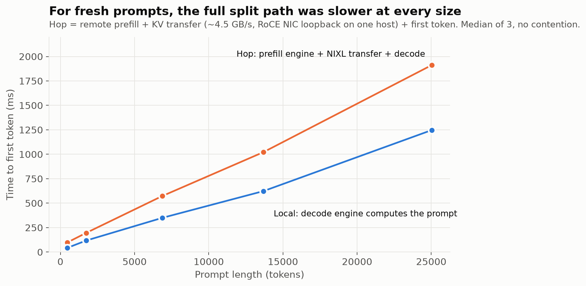
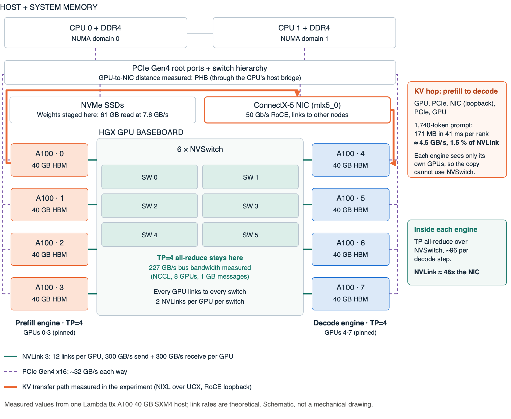
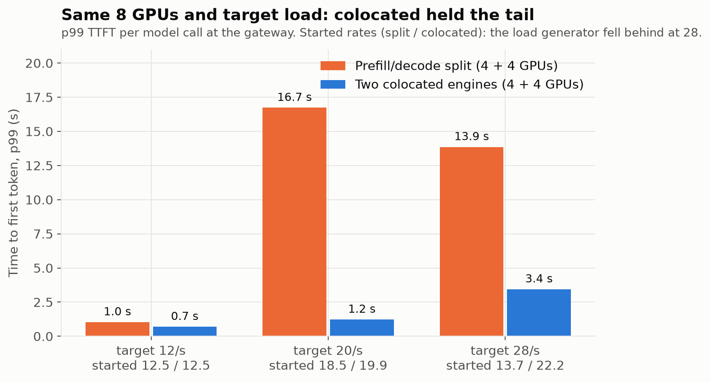
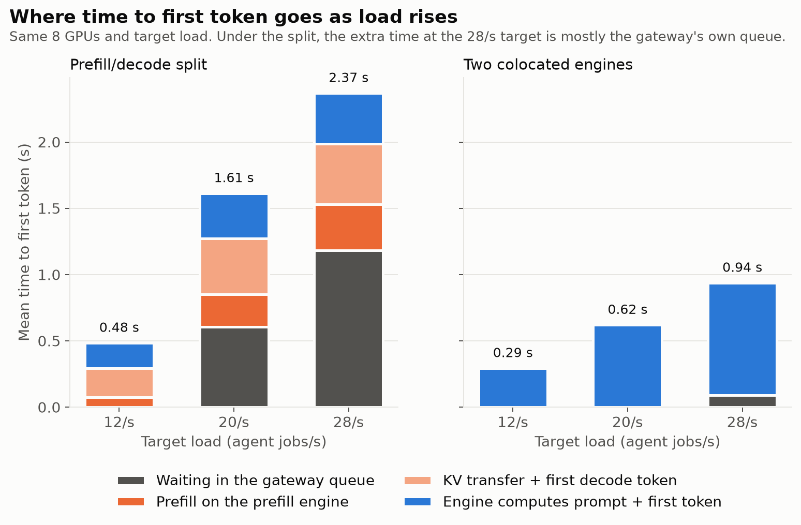
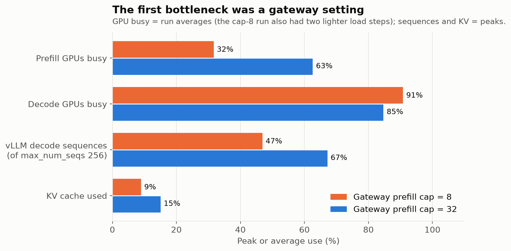
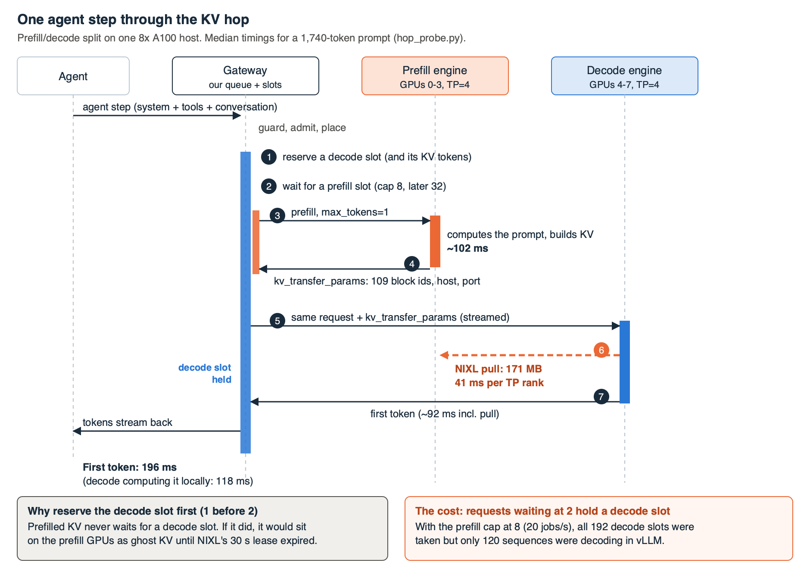
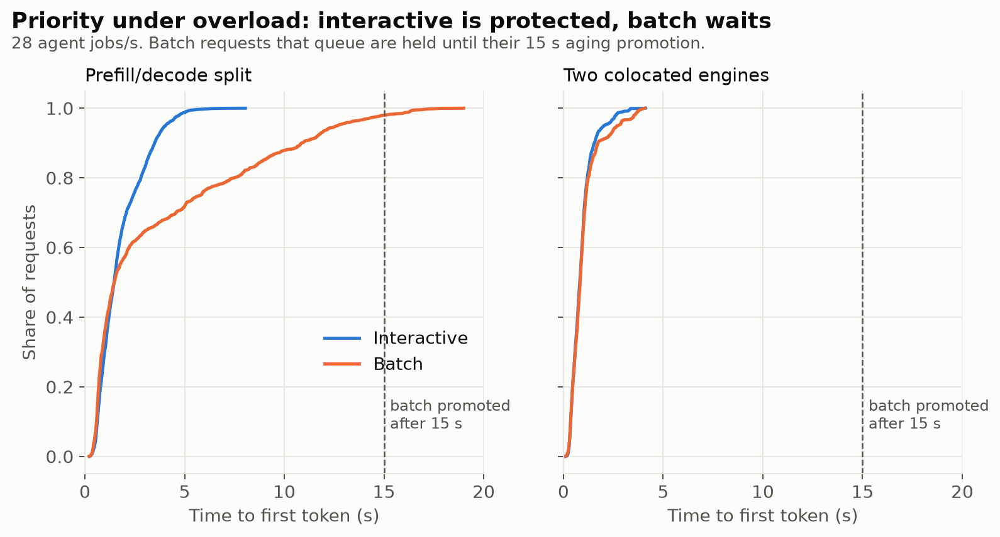
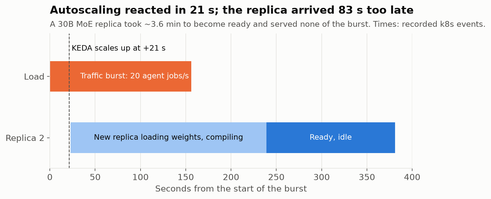
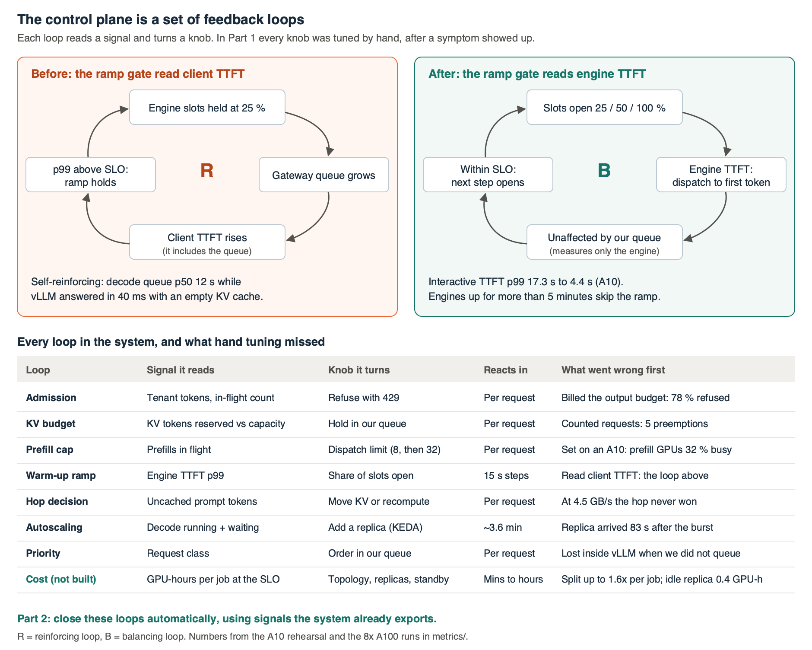

# Understanding Inference Bottlenecks

## Part 1: What actually limits a disaggregated MoE cluster serving an AI agent

I built a small inference cluster to serve a tool-using AI agent, wrote the control plane in
front of it myself, and then measured where the time went. I expected the usual suspects: GPU
memory, the KV cache, the network between prefill and decode. On the night of the experiments,
the KV cache never got above 15 % full. The biggest losses came from three other places:

* **A single line in my own gateway config** left four of eight A100s about two-thirds idle while
  277 requests waited in a queue.
* **Prefill/decode disaggregation**, the architecture I had built the cluster around, made p99
  time to first token 13× worse than two ordinary engines on the same GPUs at 20 agent jobs per
  second.
* **Autoscaling worked exactly as designed**, scaling up 21 seconds into a traffic burst, and
  still served zero requests of it, because a 30B MoE replica takes about 3.6 minutes to start.

This article walks through the cluster one building block at a time. For each block I state
what I expected from first principles, how I measured it, and what happened. The code, the raw
measurements and every chart are in the repository:
[github.com/sachscode/api-steward](https://github.com/sachscode/api-steward).

---

## The setup

**The workload.** The agent, which I call API Steward, is a private, tool-using prototype that
assesses a migration across a breaking API change. My test case is the public Stripe Python SDK
upgrade where `Invoice.upcoming` became `Invoice.create_preview`. The agent runs on synthetic
fixtures and never calls Stripe. It checks a proposed mapping; it does not generate patches or
verify that behavior is preserved. Each job runs a loop of four non-streaming model calls:
inspect the code, read the migration guide, check the proposed mapping, answer. Every call carries the same 518-token system prompt and tool schema,
and the conversation grows by a few hundred tokens per step. That shape (short prompts, a large
shared prefix, many dependent calls) is typical of agents, and it matters for every result below.

**The model.** Qwen3-30B-A3B, a mixture-of-experts model: 30.5 billion parameters, of which about
3.3 billion are used per token. Every expert must sit in GPU memory, but each token only pays the
compute of a few of them.

**The hardware.** One Lambda instance with 8× A100 40 GB SXM4, connected by NVLink inside the box
and a 50 Gb/s RoCE NIC to the outside. I designed for two such hosts, with prefill on one and
decode on the other, but on the night of the runs exactly one of these instances was available
across all of Lambda's regions. So prefill ran on GPUs 0-3 and decode on GPUs 4-7 of the same
machine. As it turned out, the KV transfer between them still went out through the RoCE NIC and
back in (more on that below). That exercises the same 50 Gb/s NIC a two-host setup would use, but
not a switch or a second host, so treat the transfer numbers as single-host loopback results.

**The serving stack.** vLLM 0.30 with tensor parallelism of 4 per engine, NIXL for moving KV cache
between engines, Kubernetes (k3s) with KEDA for autoscaling, and Prometheus plus Grafana. In front
of it sits a gateway I wrote: guardrails, admission control per tenant, placement, its own queue
per engine, the decision whether to move KV or recompute it, warm-up, and an overflow path. The
gateway and the engines are separate processes, and the agent only ever talks to the gateway.

---

## Block 1: GPU memory and the KV cache

**Expectation.** Before renting anything, I sized the system on paper:

```
KV bytes per token  = 2 (K and V) × 48 layers × 4 KV heads × 128 dims × 2 bytes = 96 KiB
Weights per GPU     = 30.5 B params × 2 bytes ÷ 4 GPUs                           = 14.2 GiB
KV per GPU          = 40 GiB × 0.90 − 14.2 GiB − ~2 GiB overhead                  = 19.8 GiB
KV per engine       ≈ 865,000 tokens
```

**Measured.** vLLM reported 14.25 GiB of weights per GPU and **878,464 tokens** of KV capacity,
within 2 % of the estimate. The only real error was my overhead guess: activations and CUDA graphs
took 1.1 GiB, not 2.

Two details made the arithmetic work. Grouped-query attention is why this model stores 4 KV heads
instead of 32, which shrinks the KV cache eightfold. And tensor parallelism should not exceed the
number of KV heads: at TP=8, four KV heads across eight GPUs means every head is stored twice.

**What happened under load.** My hypothesis was that the engine's sequence limit (256) would bind
before the KV cache (about 480 sequences at the agent's prompt length). Neither came close. Peak KV
use was **15 %**, there were **zero preemptions** in every run, and the engine never ran more
than 172 sequences. For agent-length prompts on this hardware, KV memory was simply not the
constraint. That changes what you should buy and what you should tune.

---

## Block 2: The interconnect and the KV hop

In a disaggregated design, one engine computes the prompt (prefill) and another generates tokens
(decode). The KV cache built during prefill has to move to the decode engine, or the decode engine
has to compute the prompt again. The question is when moving beats recomputing.

**Expectation.** The transfer adds time; it pays off only if it saves more than it costs.

**Measured.** I sent fresh prompts of 500 to 25,000 tokens, one at a time, down both paths and
timed the first token. The hop path is the whole split: prefill on the prefill engine, the NIXL
transfer, then the decode engine's first token. The local path is the decode engine computing the
prompt itself. For fresh prompts under no contention, the full split path was slower at every
size:



At 25,000 tokens the hop path took 1.91 s and the local path 1.25 s. The hop path does all the
prefill work anyway, on the other engine, and then adds a 2.5 GB transfer.

That is a narrower result than "moving KV never pays". The transfer plus the decode engine's first
token, on their own, took 0.67 s at 25,000 tokens, about half the cost of recomputing. So when the
KV already exists, because an earlier turn produced it or because the prefill ran on GPUs that
would otherwise sit idle, moving it can win. This probe did not test either case.

A useful rule of thumb falls out of this. This engine prefills about 20,000 tokens per second,
and each token produces 96 KiB of KV, so prefill *produces* KV at roughly 2 GB/s. The link moved
it at about 4.5 GB/s. So the transfer added about 2 ÷ 4.5 ≈ **44 %** on top of the prefill
time. Over NVLink, at 300 GB/s, the same ratio would be under 1 %. Before building a
disaggregated cluster, compute *KV bytes produced per second of prefill ÷ link bandwidth*. That
ratio is the latency tax a fresh prompt pays for the split. The split has to earn it back
somewhere else: prefill capacity that would otherwise be idle, KV reuse, or keeping long prefills
away from decoding.

One surprise: the transfer between two engines on the same machine went out through the NIC and
came back in. Each engine was pinned to its own four GPUs, so neither process could address the
other's memory directly. The NIC's receive counter matched NIXL's byte count to within protocol
overhead.



Inside each engine, tensor-parallel traffic stays on the NVSwitch fabric, which measured 227 GB/s
of all-reduce bandwidth. The KV transfer between the engines took the long way: out of the GPU
over PCIe, through the NIC and back, at about 4.5 GB/s, roughly 1.5 % of what NVLink offers.

I also verified that the moved KV was actually used. Across all runs, vLLM reported 4.61 million
tokens' worth of KV pulled, and the decode engine counted 4.51 million prompt tokens it received
from outside instead of computing. The 2 % gap is the transfer moving whole 16-token blocks.

---

## Block 3: Disaggregated or colocated?

**Expectation.** Disaggregation is supposed to protect token generation from long prefills that
would otherwise interrupt it. Its cost is the transfer and an extra network round trip.

**Measured.** I ran the same agent traffic profile on the same eight GPUs in two layouts: a
prefill/decode split (four GPUs each), and two ordinary engines that each do both.



At a target of 20 agent jobs per second, p99 time to first token for individual model calls,
measured at the gateway, was **16.7 s split and 1.2 s colocated**. Whole agent jobs (four calls)
that completed took a median of 29.0 s split and 12.1 s colocated. Against a 2-second p99 target, the split met
it only at the 12 jobs/s step, and the colocated engines also met it at 20. And the one thing the
split should have improved, inter-token latency, was the same in both: 24.4 ms against 24.8 ms.

One caveat on the load. My load generator has a fixed pool of 256 worker threads and records a
job's start time only when a thread picks it up. When jobs run long, the pool fills, jobs back up
inside the generator, and that wait never appears in the latency numbers. At the 20 jobs/s target
the split actually started 18.5 jobs/s and the colocated engines 19.9. At the 28 target it was
13.7 against 22.2, so that step is not a like-for-like comparison, and both layouts' overload
latency is understated. The 12 and 20 steps hold. Exact capacity at the 2-second target needs a
rerun with a generator that cannot fall behind.

The reasons are specific to this workload. Agent prompts here are 500 to 2,000 tokens, so
prefill is quick and rarely stalls decoding. Under the split, the prefill GPUs sat at about 63 %
busy while the decode GPUs saturated. With two colocated engines, all eight GPUs did useful work.

Breaking time to first token into its parts shows where the split loses. At light load the
difference is the prefill round trip and the transfer. As load rises, the split's time in the
gateway's own queue grows: at the 28 jobs/s target it is about half of a 2.4-second average, while
the colocated engines average 0.9 seconds and barely queue at all:



This is not a verdict against disaggregation in general. With prompts of 16,000 to 32,000 tokens
mixed into the traffic, a long prefill would stall every sequence decoding beside it, and the
split's isolation would start to matter. I did not run that case. For short-prompt agent
workloads on a 50 Gb NIC, though, the split cost capacity and tail latency and bought nothing.

---

## Block 4: The gateway is a building block too

This was the part I least expected to write about, because I wrote the gateway.

**On the A100.** I had set the gateway to send at most 8 concurrent requests to the prefill
engine. I chose that number during a rehearsal on a single A10 GPU with a tiny model, where it
made sense. On the A100s, it starved the prefill GPUs:



With the cap at 8, the prefill GPUs were about 32 % busy and 277 requests waited in the gateway's
queue, while the engine had room for more than twice the sequences it was running. Worse, my
gateway reserves a decode slot before starting prefill, so that prefilled KV never waits for a
place to go. That meant requests queued for prefill were also holding decode capacity. Raising the
cap to 32, at the same 20 jobs per second, halved median time to first token (2.0 s to 1.1 s),
cut p99 from 27 s to 17 s, shrank the prefill queue from 65 to 12 and let the engine run 172
sequences instead of 120. The limit moved to where it belonged: decode slots and decode GPU time.
(The GPU-busy figures in the chart are averages over each whole run, and the first run also
included two lighter load steps, so read them as direction rather than precise values.)

The sequence below shows the mechanism. Reserving the decode slot first (step 1) is deliberate:
it means prefilled KV never sits waiting for somewhere to go. The price is that every request
waiting for a prefill slot (step 2) is already holding decode capacity.



**On the A10 rehearsal**, three other control-plane decisions caused trouble before I fixed them:

* **Warm-up judged on the wrong signal.** After a restart, the gateway opens an engine's capacity
  in steps (25 %, 50 %, 100 %) and holds a step if latency looks bad. I fed it the latency the
  *client* saw, which includes time spent in the gateway's own queue. With capacity throttled, the
  queue grew, latency rose, and the ramp held: queue wait reached 12 seconds while the engine
  answered in 40 ms. Judging the engine on its own latency fixed it, and cut p99 time to first
  token from 17.3 s to 4.4 s. (A later review found a gap: for split requests, my "engine" clock
  still included the wait for a prefill slot. It is fixed now. The A100 runs predate the fix, but
  their engines had been up for more than five minutes, so the ramp was not in play.)
* **Counting requests instead of tokens.** The gateway capped each engine at 16 requests. Forty
  long prompts arriving in one second all fitted under that cap and overfilled the KV cache, so
  vLLM evicted five of them. Reserving each request's tokens against the engine's actual KV
  capacity brought preemptions to zero.
* **Billing the budget instead of the usage.** Tenants were charged each request's maximum output
  length, about three times what was actually generated, so 78 % of jobs were refused for using
  quota they never consumed. Reserving at admission and refunding unused tokens on completion
  fixed it.

**Priority works while the gateway is the one waiting.** Under overload, the queue did what it
was designed to do. Interactive requests finished within about 5 seconds, while queued batch
requests were held until their 15-second aging promotion:



**Priority only works where something waits.** The gateway puts interactive requests ahead of
batch work in its queue. On the A100, with 192 decode slots per engine, a burst of 48 requests
fitted entirely inside the engine and never queued in the gateway. vLLM then served them in
arrival order, and short interactive requests waited behind long batch prompts: 2.4 s against
1.65 s. A gateway's priority policy only holds while the gateway is the one doing the waiting.
Passing priority through to the engine (vLLM supports a priority scheduling policy) is the fix I
have not built yet.

The common thread: each of these controls was reasonable on its own, and each one made the GPUs
wait. When latency is bad, look at what your router and queue are doing to the GPUs you already
have before buying more.

---

## Block 5: Scaling and warm-up

**Expectation.** Kubernetes event-driven autoscaling (KEDA) adds a decode engine when decode load
crosses a threshold.

**Measured.** I sent a burst of 20 agent jobs per second for two and a half minutes to a single
decode engine.



KEDA saw the pressure and scaled up 21 seconds into the burst. (These times come from the
Kubernetes events I recorded right after the run; the derived timeline is in the repository, but
the raw events expired.) The new replica then spent about
three and a half minutes loading 57 GB of weights, compiling kernels and capturing CUDA graphs. It
became ready 83 seconds after the burst had ended, sat idle through KEDA's three-minute cooldown,
and was removed having served nothing. Meanwhile, the one engine absorbed the burst with a median
time to first token of 4.2 s, compared with 0.6 s when two engines were already running.

There is a second warm-up problem. An engine that has passed its health check is not necessarily
warm. The first 1,700-token prompt after startup took **1,014 ms** of prefill instead of about
100 ms, because vLLM compiled a mixture-of-experts kernel for a prompt shape it had not seen yet.
A warm-up that sends one short request does not cover that.

So for a model of this size, reactive autoscaling only helps with load that lasts longer than
replica startup. For shorter bursts, the realistic options are a warm standby, scaling on an
earlier signal, or cutting startup time (a persistent compile cache, fewer CUDA graph sizes, or
keeping weights resident). Warm-up requests should cover the range of prompt sizes you expect.

---

## Block 6: Tenancy

**Measured.** One tenant sent 70 % of the traffic under tight limits; two others sent the rest.
The gateway refused 541 of the flooding tenant's requests at admission, before any GPU work.
The other tenants' p99 time to first token stayed at **0.38 s**. Admission control per tenant,
enforced in the gateway, kept one customer from owning the GPUs.

---

## Block 7: The agent itself

For completeness, one result that had nothing to do with serving. On the first A100 run, **0 %**
of agent jobs completed. The model was not at fault and neither was the cluster. A tool
parameter called `operation` had no description, so the model reasonably passed the name of the
web route. Then, once described, it passed `Invoice.create_preview` without the `stripe.` prefix,
and my checker compared exact strings. Describing the parameter's format and accepting the
equivalent spelling took completion to 100 % in about 2.6 seconds per four-call job. Before you
blame the model or the serving stack for agent failures, read what the model actually sends to
your tools.

---

## The loop I did not have: cost

None of the control loops above looked at cost, and every finding has a price. The signal a
cost loop should use is GPU-hours per completed request at the latency target, which is
capacity at the SLO, not raw tokens per second.

| | Prefill/decode split | Two colocated engines |
| --- | --- | --- |
| Highest tested step within a 2 s p99 TTFT | 12/s target (12.5 started) | 20/s target (19.9 started) |
| Estimated cost per 1,000 agent jobs at that step ($15.92/h host) | $0.36 | $0.22 |

This is an estimate from arrival rates at coarse load steps, not a measured cost per completed
migration. The split missed the target at 18.5 jobs/s started, so its real capacity lies somewhere
between 12.5 and 18.5, and the split cost between about 1.1× and 1.6× as much per job. Finer steps
would pin that down. The other waste was idle capacity:
the late replica held four A100s for six minutes and served nothing, about 0.4 GPU-hours. A
cost loop would read cost per job at the SLO and idle GPU time, and its knobs are the slow,
expensive ones: topology, replica count, warm standby and the scale-in cooldown. It reacts in
minutes to hours, so it has to sit above the faster loops and set their limits rather than
compete with them.

## Rules of thumb I am taking away

1. **Size on paper first.** The arithmetic predicted KV capacity within 2 %. It is cheaper than a
   GPU hour.
2. **Compute KV production rate ÷ link bandwidth before disaggregating.** Here it was 44 %: the
   latency every fresh prompt pays for the split, which the split must earn back elsewhere.
3. **Match the architecture to the prompt length.** For short-prompt agent traffic, colocated
   engines beat a prefill/decode split on capacity and tail latency.
4. **Treat the control plane as a component that can be the bottleneck.** Alert when gateway
   queues grow while GPUs are under-used.
5. **Judge engine health on engine latency**, not on latency that includes your own queue.
6. **Reserve KV in tokens, not requests.**
7. **Do not autoscale faster than you can start.** Replica startup, not the autoscaler, sets the
   shortest burst you can absorb.

## Limitations

This is one model, one workload shape and one host. The KV transfer used a real RoCE NIC in
loopback, not a switch between two machines. I did not run the long-prompt case where
disaggregation should help, or a case where KV already existed. The load generator fell behind
its target under overload, so the overload steps understate latency. Time to first token is
measured per model call at the gateway, not per agent job. The autoscaling times come from events
recorded by hand after the run. The agent assesses a migration plan; it does not write or verify
patches. The overflow path to an external provider was tested only against a mock. Read the
numbers as one careful case study, not a benchmark.

## Next: automated performance tuning



I made most of these changes by hand, based on what I saw in the measurements. Some were
parameter changes, like raising the gateway's limit on concurrent prefill calls (its prefill
dispatch cap). I also changed the signal driving the warm-up ramp and added a control loop to
manage the KV token budget. For KV movement, the measurements showed it wasn't worth doing on this
hardware.

An automatic tuner could have helped with the dispatch cap. Parameter tuning alone wouldn't have
corrected the signal the warm-up loop was using. No tuning of the scaling trigger could have
shortened the three and a half minutes it took a new replica to become ready. Prefill and decode
were coupled: requests waiting for prefill held decode slots, so a tuner watching either pool alone
could misidentify the bottleneck.

In Part 2, I'll use these measurements to work through which tuning decisions we can automate.
I'll look at what each loop needs to measure, which knobs it can safely adjust, and how to
coordinate those adjustments when loops share capacity.

*Code, data and dashboards:* [github.com/sachscode/api-steward](https://github.com/sachscode/api-steward).
*Built as the final project for AI Inference Engineering & Systems Design.*
