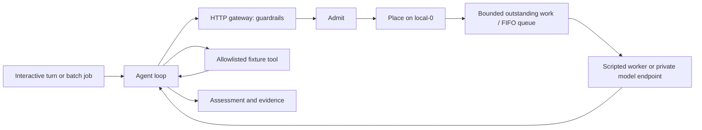

# Part 0: what API Steward serves

Decision: **Track B, tool-using agent.** No separate RAG track is needed.

## Application statement

API Steward is a private API maintenance agent. A developer requests a bounded
API/SDK upgrade; the agent inspects the integration, reads the relevant upgrade
instructions, checks its proposed changes, and returns a migration assessment
with evidence and outstanding validation. The first case is the Stripe
subscription invoice-preview upgrade described in [the project plan](../PROJECT_PLAN.md).

The complete product will generate a patch and establish behavior preservation
through independent tests. This first application slice stops at an assessment.
It uses a synthetic integration and a curated migration note. The real public
source baseline has not been qualified, and no Stripe API calls are made.

## The user turn

Example request: “Assess the Stripe invoice-preview upgrade to SDK v12 and API
2025-03-31.basil.”

1. The model requests `inspect_integration` to read the fixture source and contract.
2. The application executes that tool and appends its observation.
3. The model requests `read_migration_guide` to read the curated upgrade note.
4. The application appends the note, then the model proposes a mapping through
   `check_migration_plan`.
5. The application checks the operation, parameter location and API version.
6. The model returns an assessment with proposed changes, evidence and limits.

The scripted worker follows this sequence deterministically. A real model can
choose different calls and repeat a failed mapping check within the step budget.
The application validates tool names and arguments regardless of model behavior.
A final answer without successful evidence from all three tools is incomplete.
`analysis_complete` means the assessment has those tool results; it does not
certify the answer's correctness or any patch. Every job explicitly records
`behavior_preservation_verified: false`.

The tools cannot read arbitrary paths, run a shell, execute generated code,
modify a repository, or call a billing API. The mapping checker compares three
strings. It is not the future independent behavior verifier.

## Serving shape and rubric mapping

| Course requirement | Part 0 implementation |
| --- | --- |
| One track | Track B only: a bounded tool-using loop. |
| Shared prefix | Stable system instructions and the same ordered tool definitions on every model call. |
| Growing conversation | User request, assistant tool calls and tool observations are retained in subsequent requests. |
| Interactive unit | One developer migration-assessment turn, potentially involving several model calls. |
| Batch unit | A background sweep of bounded assessment jobs using the same client and gateway. The initial CLI runs these sequentially. |
| All completions use the serve path | Each step calls the HTTP gateway, which validates, admits, places, queues and invokes the worker. |
| Reviewable output | Assessment, checked mapping, tool outcomes, per-call serving evidence and unresolved verification. |

The workload has repeated decode phases plus progressively longer prefill inputs.
Do not assume it is decode-bound: that depends on prompt lengths, generated
lengths, cache behavior, batching and hardware. We will characterize the real
model workload before choosing concurrency and capacity targets.

The interactive experience needs timely first progress and bounded time to a
useful assessment. Later measurement must separate client TTFT for each streamed
model call, tool latency, and total user-turn latency. Batch success is completed
useful assessments per unit time and cost, subject to interactive SLOs and quality.
Numeric SLOs remain open until a real-model baseline exists.

## Every model call follows this route



The gateway handles the entire chat envelope, including tool schemas, tool-call
IDs and observations. Only the gateway process receives the worker URL/key.
`GatewayClient` rejects a completion without matching job/step metadata and the
five recorded serving stages. There is no fallback to a direct model client.
These markers provide development evidence, not authentication: production must
also prevent application access to model workers through network policy.

| Stage | Current behavior | Remaining production work |
| --- | --- | --- |
| Guardrails | Model allowlist; fixed system/tool contract; tenant/class validation; body, context-character and output limits; reject streaming for now. | Selected-model tokenization, authentication, document authorization and production input policy. |
| Admission | Atomically limit outstanding requests to four globally and two per configured tenant; reject with 503 or 429. | Token reservations, fairness, interactive protection, durable budgets and multi-process coordination. |
| Placement | A single configured worker, `local-0`. Worker URL cannot be changed by a request. | Health/capacity-aware replica selection, tenant-aware cache affinity and stale-snapshot handling. |
| Queue | One executor worker; at most three waiters under the four-request admission cap. | Dedicated class scheduling, measured waiting budgets and engine-aware backpressure. |
| Worker | Explicit scripted mode or an OpenAI-compatible HTTP adapter. No automatic fallback. | Pinned private MoE/vLLM deployment and real tool-calling conformance. |

These are conservative local test settings, not calibrated fleet capacity.
The agent allows at most eight model calls, each requesting at most 512 output
tokens, and a 120-second turn deadline. The gateway enforces a 32,000-character
context limit including tool definitions and a 64 KiB HTTP-body limit. Characters
are not tokens; these limits must not be used for KV-cache sizing.

Queued work is cancelled on the gateway deadline. If a backend call has already
started, its admission reservation remains until it finishes. Active vLLM abort,
client-disconnect propagation and KV-block release are later work. An application
deadline can return before active worker work ends; this is not proof of GPU
cancellation. The compatible worker has a network timeout and never silently
switches to the scripted worker.

## Code map

| File | Responsibility |
| --- | --- |
| [agent.py](../api_steward/agent.py) | Conversation loop, gateway-only client, tool dispatch, evidence and budgets. |
| [tools.py](../api_steward/tools.py) | System prompt, tool definitions, argument validation and fixture mapping check. |
| [serving.py](../api_steward/serving.py) | Local HTTP entry point, admission, placement, queue and per-call evidence. |
| [workers.py](../api_steward/workers.py) | Scripted fixture worker and real-endpoint transport adapter. |
| [transport.py](../api_steward/transport.py) | Bounded JSON transport with redirects and ambient proxies disabled. |
| [tests](../tests/test_part0.py) | HTTP integration, loop boundaries, isolation, overload, failure and adapter tests. |

Python 3.11+ standard library only. An explicit loop keeps the request envelope
and serving boundary visible during this checkpoint. This does not decide the
final agent framework or commit the product to a custom orchestration framework.

## Checkpoint 1: run the local application

From the `api-steward` repository root:

```bash
python3 -m api_steward demo --output artifacts/part0/demo.json
```

This starts a temporary loopback HTTP gateway, runs one interactive assessment
and one batch assessment, and shuts the server down. No credentials or GPU are
needed. It prints `SCRIPTED FIXTURE` before any results.

Expected for each assessment:

| Call | Messages | Context characters in this fixture | Next action |
| --- | --- | --- | --- |
| 1 | 2 | 1,699 | Inspect integration. |
| 2 | 4 | 3,255 | Read migration guide. |
| 3 | 6 | 4,504 | Check proposed mapping. |
| 4 | 8 | 5,211 | Return assessment. |

These are measured serialized-character counts for the current fixture, not
model tokens. The prefix fingerprint stays constant and the full context grows.
The fingerprint records the shared system/tool contract; it does not prove the
model's chat-template ordering or any KV-cache hit.

The JSON record links job IDs to unique per-step request IDs. It includes class,
tenant, backend label, selected worker, stage sequence, character count, requested
output budget, queue wait, gateway response time, tool duration and terminal job
status. Request attempts and completed model responses are counted separately,
so a rejected or failed request does not disappear from the attempt denominator.
The scripted worker reports no token usage. Real worker usage, when
present, is labeled `worker_reported_usage`.

The gateway does not stream in this checkpoint. `gateway_e2e_s` measures a whole
completion response. It must not be labeled TTFT, prefill time, decode time or
model inference time. Fast scripted completions are not serving benchmarks.
The result file contains the final answer and is ignored by Git; keep private
real-model outputs local unless explicitly sanitized for sharing.

Before advancing, explain from your output:

1. Why did one user turn produce four model calls?
2. Which bytes form the reusable prefix, and which context is added each step?
3. Why are the final response time and a shared-prefix hash insufficient evidence
   for TTFT or KV-cache effectiveness?

## Separate processes and background jobs

Start the local gateway in one terminal:

```bash
python3 -m api_steward serve --port 8080
```

Use another terminal for an interactive turn or a bounded sequential sweep:

```bash
python3 -m api_steward run --output artifacts/part0/interactive.json
python3 -m api_steward batch --jobs 2 --tenant demo-b --output artifacts/part0/batch.json
```

Both use exactly the same gateway client. This batch command is an application
workload entry point, not the future open-loop load generator or an online eval.

## Real-model connection gate

The HTTP adapter is tested against a local protocol stub; it has not yet been
exercised against vLLM. When model selection and the serving baseline are ready,
configure the gateway's `--backend compatible`, `--worker-url` (base URL without
`/v1`) and `--model`. Configure the same model on `run` or `batch`. The application
still points only to the gateway. Optional worker authentication comes from
`STEWARD_WORKER_API_KEY` in the gateway process environment, never a CLI argument
or committed file. There is no hosted-model fallback.

For automatic tool selection, vLLM requires its auto-tool-choice setting and a
parser compatible with the selected model; the chat template must support tool
messages. Pin and test that combination before claiming real-model completion.
See the [official vLLM tool-calling documentation](https://docs.vllm.ai/en/stable/features/tool_calling/).

This reference server binds only to `127.0.0.1`. Tenant names are trusted local
labels, not authenticated identities. Do not publish it as a production service.
The stdlib HTTP listener is not a hardened ingress; the admission cap bounds
worker work, not arbitrary inbound socket/thread creation.

## Current verification and next boundary

```bash
python3 -m unittest discover -s tests -v
```

The tests cover the complete local HTTP loop, growing contexts, both workload
classes, invalid requests/tools, step exhaustion, missing evidence, truncated
tool calls, tenant and global caps, queued cancellation, active-slot retention,
worker failure recovery, tool-schema forwarding and direct-worker rejection.

**Demonstrated:** an executable Track B application skeleton and its local
guardrails/admission/placement/queue contract, with scripted inference.

**Pending:** qualified real Stripe baseline, model-generated behavior, patch
generation and independent tests, streaming TTFT, tokenizer-based admission,
private multi-tenant deployment, real MoE/vLLM/Mooncake, GPUs, NCCL/RDMA and
measured cache/capacity improvements. The full observability and benchmark plans
remain requirements, not implemented claims.

After reviewing this local checkpoint, qualify the actual integration and freeze
its acceptance contract. Then perform the paper sizing exercises before choosing
the real model and serving topology.
